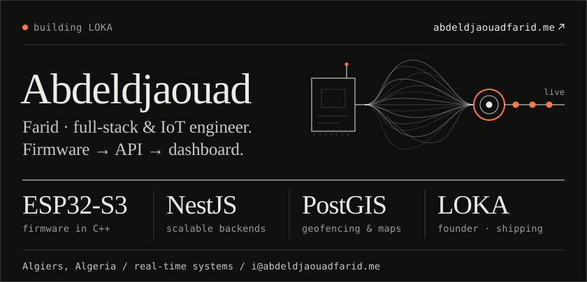
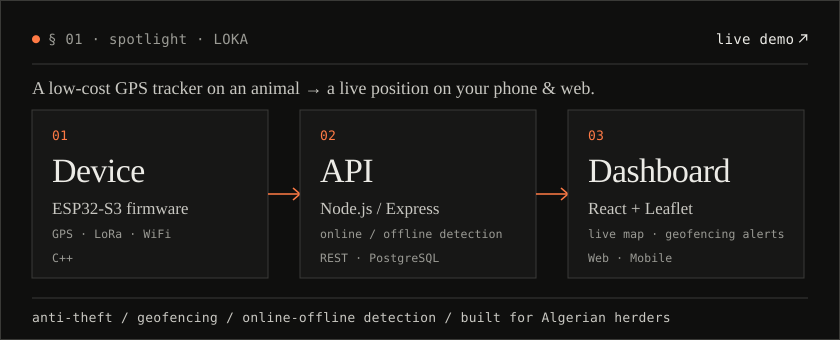
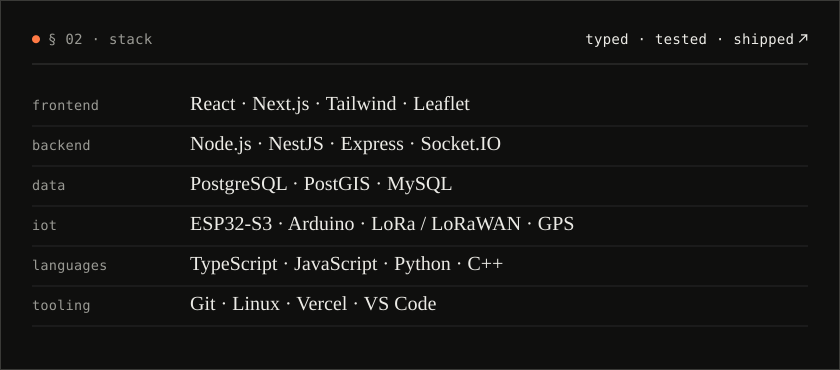
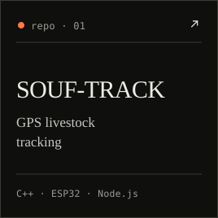
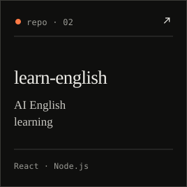
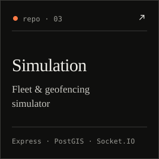
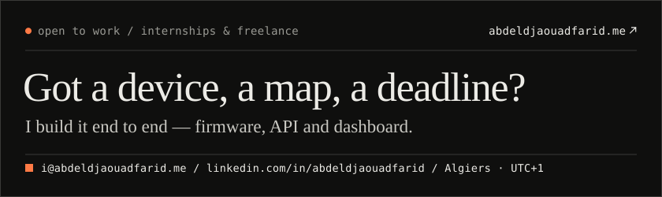

<!-- editorial dark theme · inspired by github.com/theluckystrike -->

**the pitch in one line.** full-stack & iot engineer. i build end-to-end products — from the firmware on a device, to the api behind it, to the dashboard in front of it. react · node · nestjs · postgresql · esp32. clean architecture, shipping fast. currently building **LOKA**, real-time gps livestock tracking for algerian herders.

-> **open the live demo** · [loka-livetrack.vercel.app](https://loka-livetrack.vercel.app)

### § 03 · projects

### § 04 · how i work

| | |
| :--- | :--- |
| **scope** | one device, one api, one dashboard — designed together, not glued later. |
| **realtime** | websockets, geofencing, online / offline detection as first-class features. |
| **code** | modular nestjs backends, typed everywhere, clean architecture. |
| **ship** | small milestones, live demos early, readable repos at handoff. |

### § 05 · where to find me

| | |
| :--- | :--- |
| **portfolio** | [abdeldjaouadfarid.me](https://abdeldjaouadfarid.me) |
| **email** | [i@abdeldjaouadfarid.me](mailto:i@abdeldjaouadfarid.me) |
| **linkedin** | [linkedin.com/in/abdeldjaouadfarid](https://linkedin.com/in/abdeldjaouadfarid) |
| **building** | [LOKA — live demo](https://loka-livetrack.vercel.app) |

built solo · shipped · algiers · i@abdeldjaouadfarid.me
