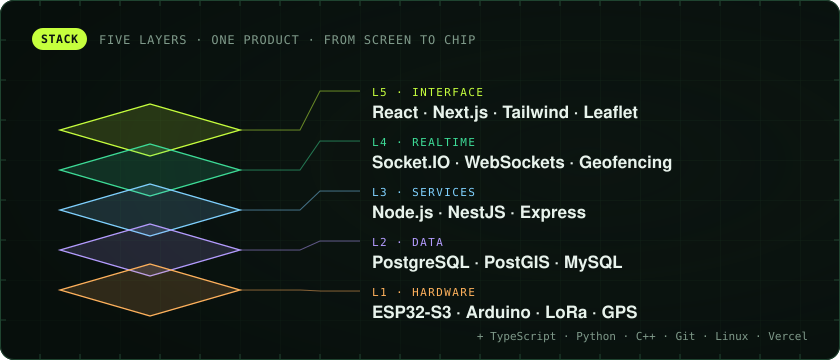
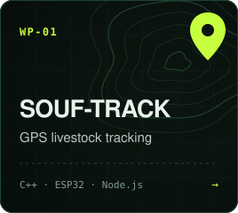
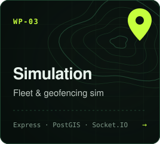

<div align="center">

<a href="https://abdeldjaouadfarid.me"></a>

<a href="https://abdeldjaouadfarid.me"></a>
<a href="https://linkedin.com/in/abdeldjaouadfarid"></a>
<a href="mailto:i@abdeldjaouadfarid.me"></a>


</div>

```text
> whoami
  full-stack & iot engineer · algiers, algeria
> currently
  shipping LOKA — gps collars for livestock, live on your phone
> i build
  firmware → api → dashboard, as one system
```

<a href="https://loka-livetrack.vercel.app"></a>

<p align="center"><a href="https://loka-livetrack.vercel.app"><b>▶ open the LOKA live demo</b></a></p>



<h3 align="center">📍 waypoints</h3>

<p align="center">
<a href="https://github.com/abdeldjaouadfarid/SOUF-TRACK"></a>
<a href="https://github.com/abdeldjaouadfarid/learn-english"></a>
<a href="https://github.com/abdeldjaouadfarid/Simulation_backend"></a>
</p>

<a href="mailto:i@abdeldjaouadfarid.me"></a>
